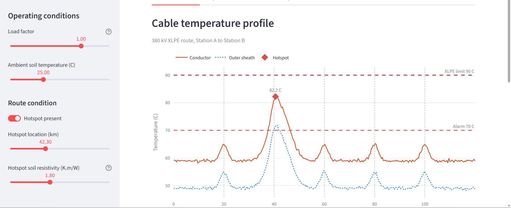
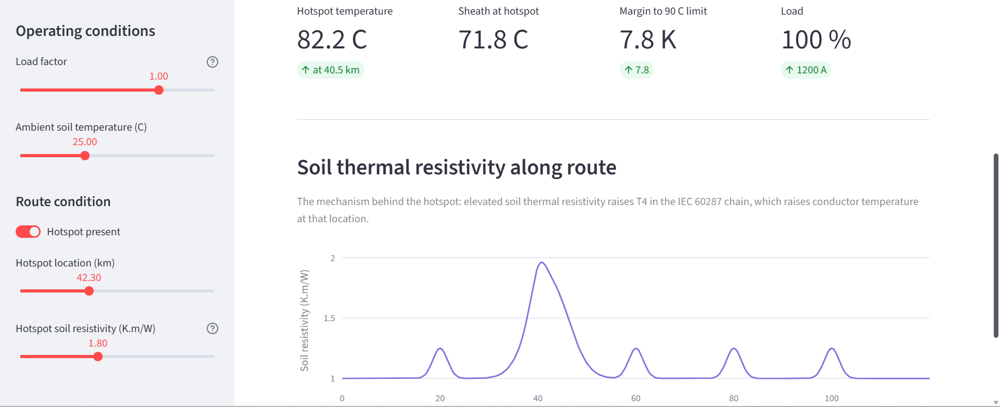
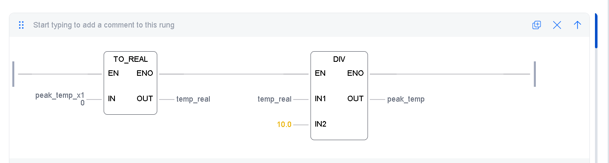
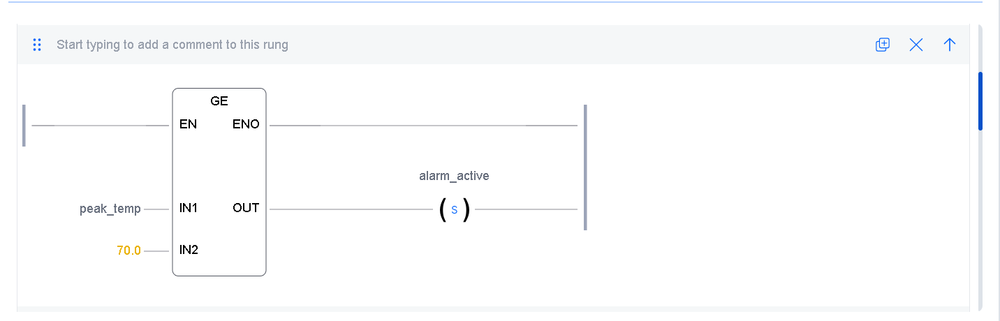
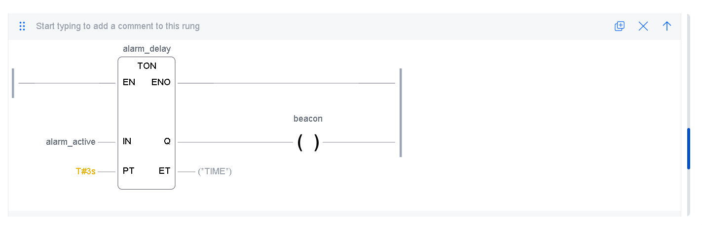
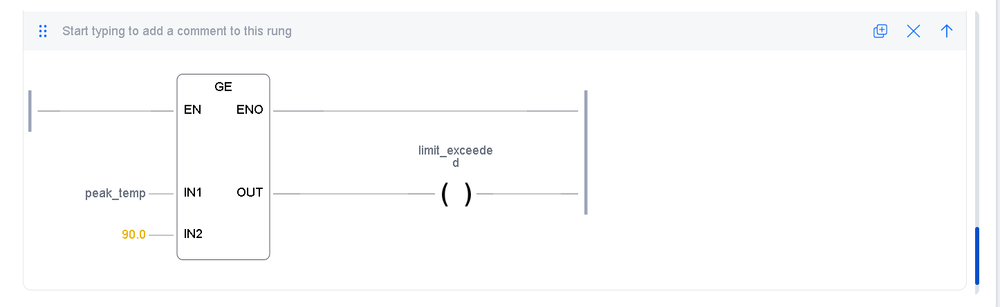
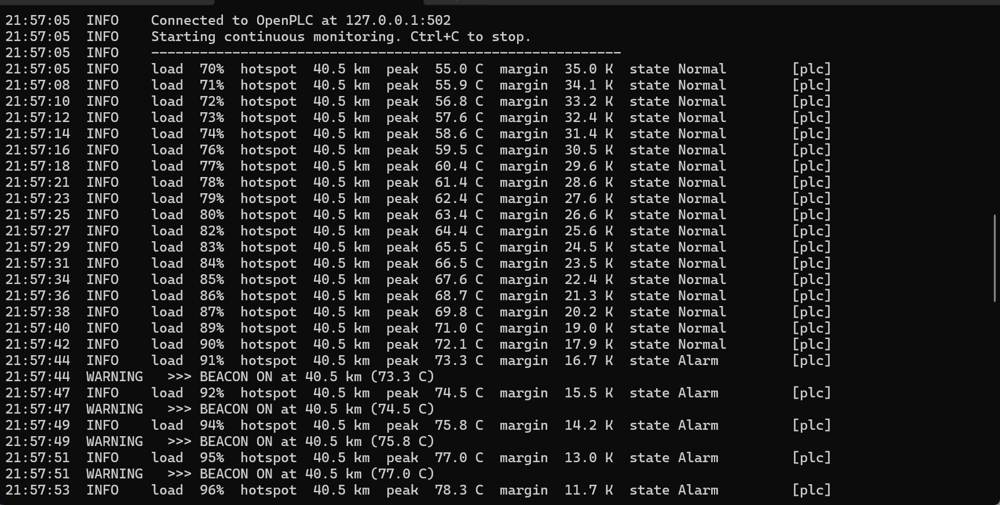
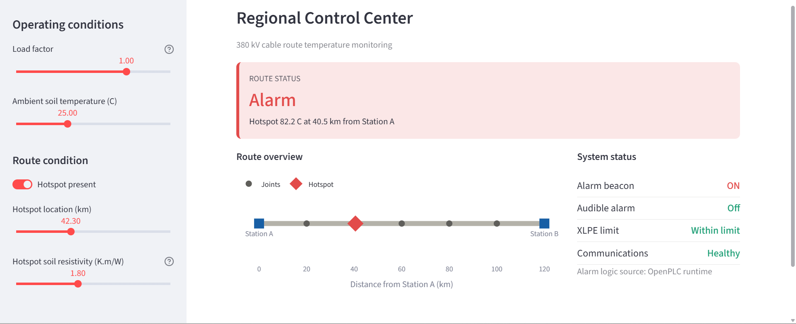

# DTS Monitoring for a 380 kV Underground Cable Circuit

A simulated Distributed Temperature Sensing (DTS) monitoring system for a 380 kV
XLPE cable circuit, built end to end: the cable thermal physics, an industrial
communication link, alarm logic running on a real PLC runtime, and two operator
interfaces.

No physical hardware was available, so the cable and the interrogator are
simulated. **The alarm decision is not.** It runs as a compiled IEC 61131-3
Ladder Diagram program on an OpenPLC runtime, reached over Modbus TCP exactly as
a field RTU would be.



---

## The problem

A cable circuit is given a current rating from one calculation that assumes the
ground around it is uniform along the whole route. It isn't. Over 120 km the soil
changes, roads cross, and sections dry out. Where the ground is dry, heat cannot
escape, so that stretch runs hotter than the rest **on exactly the same current**.

That hottest point, not the average, determines the safe loading of the entire
circuit. Without distributed measurement, its position is unknown.

In this model the soil accounts for **61 % of the total thermal resistance**
between conductor and ambient, and it is the only part that varies along the
route. Raising the local soil resistivity from 1.0 to 1.8 K·m/W moves the
conductor from **58.9 °C to 78.0 °C** with no change in current.

---

## Architecture

```
thermal_model.py  ──►  plc_bridge.py  ──►  OpenPLC Runtime  ──►  dashboard.py
  IEC 60287            Modbus TCP          Ladder Diagram        HMI + SCADA
  300 points           port 502            5 rungs, 20 ms
     [simulated]        [real protocol]      [real runtime]        [simulated]
```

| Layer | Implementation |
|---|---|
| Cable and soil thermal behaviour | `thermal_model.py`, IEC 60287 steady state |
| DTS interrogator | profile generator, 300 points over 120 km |
| Communication | Modbus TCP, holding registers and coils |
| RTU alarm logic | Ladder Diagram on OpenPLC Runtime v4 |
| Local HMI and control centre | `dashboard.py`, Streamlit |

---

## What the thermal model does

Implements the steady-state method of IEC 60287. Temperature rise is computed
from the heat generated and the series chain of thermal resistances between the
conductor and the soil:

```
Δθ = (Wc + 0.5·Wd)·T1 + (Wc·(1+λ1) + Wd)·n·T2 + (Wc·(1+λ1+λ2) + Wd)·n·(T3 + T4)
```

Losses include conductor joule loss with skin and proximity effect corrections,
and dielectric loss, which is present even at no load. Conductor temperature is
solved iteratively, because resistance depends on temperature and temperature
depends on resistance.

Hotspots are **not** inserted as an arbitrary offset. Local soil thermal
resistivity is raised, which increases T4, which raises conductor temperature at
that location. Soil drying around a loaded cable is a documented mechanism.

```
dry soil → ρ_soil rises → T4 rises → total resistance rises → conductor hotter
```



---

## The PLC program

Five rungs on a 20 ms cyclic task.

| Rung | Function |
|---|---|
| 1 | Rescale the Modbus integer back to degrees Celsius |
| 2 | Latch the alarm when the hotspot reaches 70 °C |
| 3 | Clear it only once it falls back to 68 °C |
| 4 | Three-second on-delay, then assert the beacon |
| 5 | Report immediately above the 90 °C XLPE limit |

<p align="center">
  
  
</p>
<p align="center">
  
  
</p>

**Why a deadband.** The alarm sets at 70 °C and clears at 68 °C. Without the gap,
measurement noise on a temperature sitting at the setpoint would switch the
beacon on and off repeatedly. Nuisance alarms are worse than no alarm, because
operators learn to ignore them.

**Why a three-second delay.** A single noisy sample should not call out an
operator. A cable buried 1.2 m deep has a thermal time constant measured in
hours, so three seconds costs nothing in real response time while filtering
anything faster than the process can physically change.

---

## Address map

Both sides of the link must agree on these. Getting this wrong is the most common
way a Modbus integration fails silently.

| Variable | IEC address | Modbus block | Addr | Direction |
|---|---|---|---|---|
| `peak_temp_x10` | `%QW0` | Holding register | 0 | host writes |
| `beacon` | `%QX0.0` | Coil | 0 | host reads |
| `buzzer` | `%QX0.1` | Coil | 1 | host reads |
| `limit_exceeded` | `%QX0.2` | Coil | 2 | host reads |
| `comms_ok` | `%QX0.3` | Coil | 3 | host reads |
| `alarm_state` | `%QW10` | Holding register | 10 | host reads |

Two points worth knowing:

**Incoming data uses `%QW`, not `%IW`.** In OpenPLC, `%IW` maps to Modbus input
registers and `%IX` to discrete inputs, both read-only to a Modbus master. In a
real installation the interrogator would be wired to physical input terminals and
`%IW` would be correct. Here it is simulated by a host program acting as a master,
so it must write into a writable block.

**Coil numbering is `byte × 8 + bit`.** `%QX0.0` is coil 0 and `%QX0.3` is coil 3.
`%QX100.0` would be coil 800, not 100.

**Temperatures are scaled by 10.** Modbus registers carry 16-bit integers, so
72.4 °C travels as 724 and rung 1 divides by ten. Standard SCADA practice.

---

## Results

The circuit was loaded from 70 % to 114 % of rated current with the PLC
evaluating every sample.

| Load | Hotspot | Margin to limit | State |
|---|---|---|---|
| 70 % | 55.0 °C | 35.0 K | Normal |
| 89 % | 71.0 °C | 19.0 K | Normal, timer running |
| 91 % | 73.3 °C | 16.7 K | Alarm, beacon ON |
| 107 % | 90.8 °C | −0.8 K | Critical, limit exceeded |
| 114 % | 100.9 °C | −10.9 K | Critical |



The on-delay is visible in the timestamped record: the setpoint is crossed at
21:57:40 while the state is still normal, and the beacon asserts at 21:57:44.

The latching behaviour was confirmed directly in the PLC debugger. At an
identical measured value of 69 °C the beacon was observed both ON and OFF,
depending on the direction from which that value was approached. A plain
threshold comparison cannot produce two different outputs for one input.



---

## Running it

```bash
pip install -r requirements.txt

python thermal_model.py      # prints the IEC validation table
streamlit run dashboard.py   # operator interface
python plc_bridge.py         # live monitoring loop in the terminal
```

Run the dashboard **or** the bridge loop, not both at once: they would write to
the same Modbus register.

Without a PLC running, the system falls back to equivalent Python logic so the
interface still works. The fallback is always labelled, in the sidebar and on the
control centre screen, and in the terminal log as `[fallback]` rather than
`[plc]`.

### With the PLC

1. Install OpenPLC Editor v4 and OpenPLC Runtime v4
2. Start the runtime. It listens on **port 8443 over HTTPS** and, unlike v3, has
   **no web interface** at that address
3. In the Editor: Device → Configuration, set the device to OpenPLC Runtime v4,
   IP `127.0.0.1`, Connect
4. Build and upload. Add a Modbus/TCP server under Servers, port 502
5. Run `python plc_bridge.py`. The log should read `Connected to OpenPLC`

`ladder_reference.st` is the same logic written out as Structured Text, for
reading. It is **not** the program that executes; the Ladder Diagram built in the
Editor is.

---

## Scope and assumptions

Stated so the results are read in the right context.

- **Steady state only.** Load cycling and emergency ratings would require IEC 60853.
- **Representative cable parameters.** Published typical values for a 380 kV XLPE
  circuit, not a manufacturer datasheet. The rated current of 1200 A was selected
  as a representative value. Substituting real figures changes only the parameter
  block.
- **Single-core, unarmoured construction**, typical of EHV land circuits. T2 and
  the armour loss factor are therefore zero.
- **The optics are not modelled.** The simulation reproduces what a Raman-based
  interrogator would measure, not the back-scatter process by which it measures it.
- **Hotspot position** is found by taking the peak of the computed profile at
  0.40 km sampling, not by any optical time-of-flight method.

---

## Further work

- Communications watchdog rung, so the PLC itself detects frozen or absent data.
  Without it the system cannot distinguish "the cable is cool" from "no data is
  arriving", and silence looks like good news.
- Composite state word, so SCADA reads one register rather than deriving the
  state from individual coils.
- Alarm acknowledge and reset as writable coils.
- Manufacturer datasheet cable parameters.

---

## References

- IEC 60287-1-1, current rating equations and calculation of losses
- IEC 60287-2-1, calculation of thermal resistance
- IEC 61131-3, programmable controllers, programming languages
- Anders, G. J., *Rating of Electric Power Cables in Unfavorable Thermal
  Environment*, Section 1.6.6 and Table 1-5
- OpenPLC Project, Runtime and Editor documentation

## License

MIT, see [LICENSE](LICENSE).
